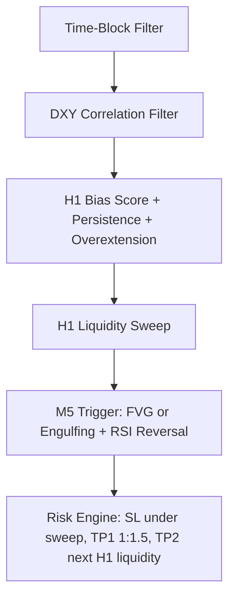

# SignalBot Monorepo

Profesjonalna platforma sygnałowa XAU/USD zbudowana jako monorepo:

- `backend/` - Python + MetaTrader5 + `supabase-py`
- `frontend/` - Next.js App Router + Tailwind CSS + Framer Motion + Shadcn/ui
- `supabase/` - wspólny schemat bazy i kontrakt Realtime

## Struktura

```text
SignalBot/
  backend/
    .env
    requirements.txt
    src/
      clients/
      config/
      data/
      models/
      services/
      strategy/
      utils/
      main.py
  frontend/
    .env.local
    app/
    components/
    lib/
    locales/
    types/
    package.json
  supabase/
    schema.sql
  README.md
```

## Architektura

1. MetaTrader 5 dostarcza ticki i historię świec dla XAU/USD oraz DXY.
2. Backend utrzymuje rolling windows w RAM i uruchamia strategię AlphaNode V2.
3. Backend zapisuje `market_data` i `signals` do Supabase.
4. Frontend subskrybuje Supabase Realtime i odświeża ticker, karty sygnałów oraz dashboard bez przeładowania.

## Konta, logowanie i subskrypcje

Projekt jest przygotowany pod Supabase Auth oraz neutralną warstwę płatności:

- `auth.users` w Supabase obsługuje logowanie, hasła, sesje i potwierdzenia e-mail.
- `public.user_accounts` przechowuje dane konta aplikacji, rolę i metadane użytkownika.
- `public.subscriptions` przechowuje status dostępu, kod planu i identyfikatory operatora płatności.
- `public.payment_events` zapisuje webhooki i historię synchronizacji płatności.
- `signals` i `market_data` są czytelne tylko dla zalogowanych kont z aktywną subskrypcją albo rolą administracyjną.

Do lokalnych testów możesz włączyć provider `mock`, ale runtime produkcyjny blokuje go automatycznie. Na produkcji ustaw rzeczywistego operatora płatności, dopisz adapter zgodny z kontraktem w `frontend/lib/billing/provider.ts` albo ustaw standardowy checkout przez `BILLING_CHECKOUT_URL` i webhook `POST /api/billing/webhook/[provider]`. Webhook zawsze wymaga `BILLING_WEBHOOK_SECRET`.

### Zmienne frontendowe dla kont i płatności

W `frontend/.env.local` ustaw:

```env
NEXT_PUBLIC_SUPABASE_URL=https://your-project.supabase.co
NEXT_PUBLIC_SUPABASE_ANON_KEY=your-anon-key
NEXT_PUBLIC_SITE_URL=https://your-domain.example
SUPABASE_SERVICE_ROLE_KEY=your-service-role-key
SUPABASE_MARKET_DATA_TABLE=market_data
SUPABASE_SIGNALS_TABLE=signals
SIGNAL_SYMBOL=XAUUSD
ENABLE_MOCK_BILLING=false
BILLING_PROVIDER=lemon_squeezy
BILLING_WEBHOOK_SECRET=strong-random-secret
BILLING_CHECKOUT_URL=https://checkout-provider.example/session
```

`BILLING_PROVIDER` może przyjąć nazwę operatora, np. `stripe`, `paddle`, `payu`, `easycart`, `lemon_squeezy` albo własną nazwę adaptera. Webhook powinien aktualizować `subscriptions`; frontend nigdy sam nie nadaje produkcyjnego dostępu.

## Szybki Start Backend

1. Utwórz plik `backend/.env`.
2. Uzupełnij co najmniej:
   - `SUPABASE_URL`
   - `SUPABASE_SERVICE_ROLE_KEY`
   - `MT5_SYMBOL`
   - `DXY_SYMBOL`
   - opcjonalnie dane logowania MT5
3. Uruchom:

```bash
cd backend
python -m venv venv
venv\Scripts\activate
pip install -r requirements.txt
python -m src.main
```

### Najważniejsze zmienne backendu

- `SEED_CANDLE_COUNT` - liczba świec M1 trzymanych do analizy i agregacji
- `H1_SEED_CANDLE_COUNT` - historia H1 dla biasu XAU
- `DXY_SEED_H1_COUNT` - historia H1 dla biasu DXY
- `SHADOW_PROFILE` - profil silnika dla trybu `SHADOW`, domyślnie `RELAXED`
- `SHADOW_CSV_PATH` - lokalny raport zamkniętych sygnałów trybu `SHADOW`
- `SHADOW_DIAGNOSTICS_CSV_PATH` - lokalny raport kandydatów i odrzuceń trybu `SHADOW`
- `SIGNAL_EXPIRY_MINUTES` - maksymalny czas życia sygnału
- `TRADING_TIMEZONE` - lokalna strefa sesyjna, domyślnie `Europe/Warsaw`
- `MARKET_DATA_THROTTLE_SEC` - jak często backend publikuje snapshot rynku do Supabase
- `H1_BIAS_MIN_SCORE` - minimalny score H1 wymagany do uznania kierunku
- `H1_BIAS_PERSISTENCE_BARS` - ile zamkniętych świec H1 musi utrzymać się bias
- `H1_BIAS_MAX_DISTANCE_ATR` - maksymalny dystans live price od EMA200 w ATR(H1), zanim bias zostanie uznany za zbyt rozciągnięty
- `BACKTEST_H1_BIAS_MIN_SCORE` - opcjonalny override score H1 tylko dla backtestu
- `BACKTEST_H1_BIAS_PERSISTENCE_BARS` - opcjonalny override persistence tylko dla backtestu
- `BACKTEST_H1_BIAS_MAX_DISTANCE_ATR` - opcjonalny override twardego progu `OVEREXTENDED` tylko dla backtestu
- `BACKTEST_H1_SOFT_OVEREXTENDED_ATR` - miękki próg `OVEREXTENDED` tylko dla backtestu `RELAXED`
- `BACKTEST_FROM` / `BACKTEST_TO` - opcjonalny zakres dat backtestu; jeśli ustawisz oba, mają priorytet nad `BACKTEST_LOOKBACK_DAYS`
- `BACKTEST_RESEARCH_MIN_BIAS_AGE_BARS` - minimalny wiek biasu H1 dopuszczany dla sygnałów `RESEARCH_M5`
- `BACKTEST_RESEARCH_MAX_BIAS_AGE_BARS` - maksymalny wiek biasu H1 dopuszczany dla sygnałów `RESEARCH_M5`
- `BACKTEST_RESEARCH_MIN_DISTANCE_TO_EMA_ATR` - minimalny dystans od EMA200 w ATR(H1) dla sygnałów `RESEARCH_M5`
- `BACKTEST_RESEARCH_FIRST_PER_DAY_SIDE` - przepuszcza tylko pierwszy sygnał `RESEARCH_M5` na dany dzień i kierunek
- `BACKTEST_RESEARCH_FIRST_PER_REFERENCE` - przepuszcza tylko pierwszy sygnał `RESEARCH_M5` na daną strefę płynności w obrębie tej samej sesji
- `BACKTEST_RESEARCH_BLOCK_BUY_WITH_BULLISH_DXY` - blokuje `RESEARCH_M5 Buy`, gdy DXY ma bias `BULLISH_DXY`
- `BACKTEST_RESEARCH_BLOCK_BUY_WITH_UNAVAILABLE_DXY` - blokuje `RESEARCH_M5 Buy`, gdy bias DXY jest niedostępny (`UNAVAILABLE`)

## Tryb Backtest

Tryb `BACKTEST` uruchamia AlphaNode V2 na historycznych danych z MT5, bez publikowania sygnałów do Supabase i bez udziału frontendu. To narzędzie do strojenia logiki, porównywania filtrów i analizy jakości setupów.

### Jak uruchomić

W `backend/.env` ustaw:

```env
APP_MODE=BACKTEST
SUPABASE_URL=https://your-project.supabase.co
MT5_SYMBOL=XAUUSD
DXY_SYMBOL=DXY
BACKTEST_CSV_PATH=backtest_results.csv
BACKTEST_DIAGNOSTICS_CSV_PATH=backtest_diagnostics.csv
BACKTEST_PROFILE=RELAXED
BACKTEST_MIN_CONFIDENCE=0.70
BACKTEST_COOLDOWN_MINUTES=20
BACKTEST_REQUIRE_EXECUTION_SESSION=true
BACKTEST_LOOKBACK_DAYS=20
BACKTEST_FROM=
BACKTEST_TO=
BACKTEST_INCLUDE_RESEARCH_SIGNALS=false
SIGNAL_SL_ATR_MULTIPLIER=1.1
SIGNAL_MAX_STOP_DISTANCE=5.0
H1_BIAS_MIN_SCORE=3
H1_BIAS_PERSISTENCE_BARS=2
H1_BIAS_MAX_DISTANCE_ATR=2.5
BACKTEST_H1_BIAS_MIN_SCORE=3
BACKTEST_H1_BIAS_PERSISTENCE_BARS=1
BACKTEST_H1_BIAS_MAX_DISTANCE_ATR=2.5
BACKTEST_H1_SOFT_OVEREXTENDED_ATR=3.0
BACKTEST_RESEARCH_MIN_BIAS_AGE_BARS=2
BACKTEST_RESEARCH_MAX_BIAS_AGE_BARS=6
BACKTEST_RESEARCH_MIN_DISTANCE_TO_EMA_ATR=1.0
BACKTEST_RESEARCH_FIRST_PER_DAY_SIDE=true
BACKTEST_RESEARCH_FIRST_PER_REFERENCE=true
BACKTEST_RESEARCH_BLOCK_BUY_WITH_BULLISH_DXY=true
BACKTEST_RESEARCH_BLOCK_BUY_WITH_UNAVAILABLE_DXY=true
SEED_CANDLE_COUNT=400
H1_SEED_CANDLE_COUNT=260
DXY_SEED_H1_COUNT=260
```

Następnie uruchom:

```bash
cd backend
python -m src.main
```

Uwaga:

- nawet w trybie `BACKTEST` aplikacja nadal inicjalizuje MetaTrader 5, bo dane historyczne są pobierane z terminala MT5
- terminal MT5 musi być uruchomiony, zalogowany i mieć dostęp do symboli ustawionych w `MT5_SYMBOL` oraz `DXY_SYMBOL`
- `SUPABASE_SERVICE_ROLE_KEY` nie jest wymagany do zapisu w `BACKTEST`, ale `SUPABASE_URL` nadal musi istnieć w konfiguracji

### Co dokładnie robi backtest

1. Backend startuje w trybie `BACKTEST`, gdy `APP_MODE=BACKTEST`.
2. Pobiera historię M1 dla XAU oraz H1 dla XAU i DXY z MT5.
3. Buduje rolling engine i zasiewa go początkowym fragmentem historii.
4. Przechodzi świeca po świecy po danych M1.
5. W każdym kroku aktualizuje tylko te świece H1 i DXY H1, które byłyby już znane w danym momencie testu.
6. Uruchamia `evaluate_signal(...)` tak samo jak w live, ale z profilem backtestowym.
7. Zanim sygnał trafi do wyników, przechodzi przez dodatkowe filtry jakościowe backtestu.
8. Zaakceptowany sygnał jest symulowany świeca po świecy aż do `TP`, `SL` albo `SIGNAL_EXPIRY_MINUTES`.
9. Jeśli `TP` i `SL` wypadają w tej samej świecy M1, backtest liczy konserwatywnie `SL`.
10. Wyniki trafiają do `backtest_results.csv`, a pełna diagnostyka do `backtest_diagnostics.csv`.
11. Na końcu logowany jest raport ogólny oraz raport `tradeable-only`.

### Profile backtestu

Backtest obsługuje dwa profile:

- `BACKTEST_PROFILE=STRICT` - zachowuje się jak tryb live i nie luzuje warunków wejścia
- `BACKTEST_PROFILE=RELAXED` - profil badawczy, który nadal respektuje strukturę systemu, ale pozwala szybciej zebrać próbki do analizy

W `RELAXED`:

- blok DXY nie wycina sygnałów tak agresywnie jak w live
- Time-Block nie zatrzymuje całej analizy poza oknami London / NY
- reclaim po sweepie może potrwać dłużej
- jeśli pełny sweep H1 nie wystąpi, silnik może użyć badawczego fallbacku mikro-płynności M5
- trigger M5 nadal jest lżejszy niż w `STRICT`, ale wymaga momentum reclaim oraz dodatkowego potwierdzenia patternem lub RSI

To nadal nie jest profil live. Jego celem jest odkrycie, czy koncepcja reaguje na sensowne fragmenty rynku.

### Filtry jakościowe backtestu

Backtest ma dodatkowe filtry, które nie wpływają na tryb live:

- `BACKTEST_MIN_CONFIDENCE=0.70` - minimalny confidence, aby setup liczył się jako transakcja
- `BACKTEST_COOLDOWN_MINUTES=20` - blokada kolejnych wejść przez określony czas po zaakceptowanym sygnale
- `BACKTEST_REQUIRE_EXECUTION_SESSION=true` - wymaga trybu `EXECUTION`, nawet jeśli `RELAXED` nadal analizuje świece poza sesją
- `BACKTEST_INCLUDE_RESEARCH_SIGNALS=false` - domyślnie nie wlicza do wyniku setupów `RESEARCH_M5`; pozostają one w diagnostyce
- `SIGNAL_SL_ATR_MULTIPLIER=1.1` - odrzuca setupy, których stop jest za szeroki względem bieżącego ATR M5
- `SIGNAL_MAX_STOP_DISTANCE=5.0` - dodatkowy twardy limit szerokości stopa w cenie instrumentu
- `BACKTEST_RESEARCH_MIN_BIAS_AGE_BARS=2` - odrzuca sygnały `RESEARCH_M5`, jeśli bias H1 jest jeszcze zbyt świeży
- `BACKTEST_RESEARCH_MAX_BIAS_AGE_BARS=6` - odrzuca sygnały `RESEARCH_M5`, jeśli bias H1 jest już zbyt stary
- `BACKTEST_RESEARCH_MIN_DISTANCE_TO_EMA_ATR=1.0` - odrzuca sygnały `RESEARCH_M5`, jeśli wejście jest zbyt blisko EMA200
- `BACKTEST_RESEARCH_FIRST_PER_DAY_SIDE=true` - odrzuca kolejne sygnały `RESEARCH_M5` w tym samym dniu i kierunku, żeby ograniczyć overtrading
- `BACKTEST_RESEARCH_FIRST_PER_REFERENCE=true` - odrzuca kolejne wejścia `RESEARCH_M5` w tę samą strefę `reference_liquidity` w obrębie tej samej sesji
- `BACKTEST_RESEARCH_BLOCK_BUY_WITH_BULLISH_DXY=true` - odrzuca `RESEARCH_M5 Buy`, jeśli DXY ma przeciwny bias i rośnie przeciwko złotu
- `BACKTEST_RESEARCH_BLOCK_BUY_WITH_UNAVAILABLE_DXY=true` - odrzuca `RESEARCH_M5 Buy`, jeśli DXY nie było jeszcze dostępne i filtr korelacji nie może zostać uczciwie oceniony

### H1 Bias Tuning

Od tej wersji bias H1 jest stabilizowany zanim M5 dostanie prawo do szukania wejścia:

- bias liczony jest z ostatniej zamkniętej świecy H1, a nie z live ticka "dopinającego" bieżącą godzinę
- kierunek H1 dostaje score oparty o EMA200, nachylenie EMA, pozycję względem Kumo, relację Tenkan/Kijun oraz prostą strukturę poprzedniej świecy
- bias musi utrzymać się przez określoną liczbę zamkniętych świec H1
- jeśli live price jest zbyt daleko od EMA200 względem ATR(H1), system oznacza stan jako `OVEREXTENDED` i blokuje nowy sygnał

Domyślne ustawienia:

```env
H1_BIAS_MIN_SCORE=3
H1_BIAS_PERSISTENCE_BARS=2
H1_BIAS_MAX_DISTANCE_ATR=2.5
```

Domyślne strojenie backtestu `RELAXED`:

```env
BACKTEST_H1_BIAS_MIN_SCORE=3
BACKTEST_H1_BIAS_PERSISTENCE_BARS=1
BACKTEST_H1_BIAS_MAX_DISTANCE_ATR=2.5
BACKTEST_H1_SOFT_OVEREXTENDED_ATR=3.0
BACKTEST_RESEARCH_MIN_BIAS_AGE_BARS=2
BACKTEST_RESEARCH_MAX_BIAS_AGE_BARS=6
BACKTEST_RESEARCH_MIN_DISTANCE_TO_EMA_ATR=1.0
BACKTEST_RESEARCH_FIRST_PER_DAY_SIDE=true
BACKTEST_RESEARCH_FIRST_PER_REFERENCE=true
BACKTEST_RESEARCH_BLOCK_BUY_WITH_BULLISH_DXY=true
BACKTEST_RESEARCH_BLOCK_BUY_WITH_UNAVAILABLE_DXY=true
```

Praktyczne strojenie:

- więcej sygnałów: obniż `H1_BIAS_MIN_SCORE` do `2`
- stabilniejszy bias: podnieś `H1_BIAS_PERSISTENCE_BARS` do `3`
- mniej spóźnionych wejść po impulsie: obniż `H1_BIAS_MAX_DISTANCE_ATR` do `1.8-2.2`
- większa tolerancja na trend: podnieś `H1_BIAS_MAX_DISTANCE_ATR` do `3.0`
- tylko dla backtestu `RELAXED`: zostaw live bez zmian, a testowo użyj `BACKTEST_H1_BIAS_PERSISTENCE_BARS=1`
- miękki wariant `OVEREXTENDED`: ustaw `BACKTEST_H1_SOFT_OVEREXTENDED_ATR=3.0`, aby zakres `2.5-3.0 ATR` nie blokował całkowicie biasu, ale przechodził z lekko obniżonym `confidence`

### Testowanie większej liczby dni

Parametr `BACKTEST_LOOKBACK_DAYS` pozwala pobrać większą próbkę historyczną bez ręcznego grzebania w kodzie.

Przykłady:

```env
BACKTEST_LOOKBACK_DAYS=5
BACKTEST_LOOKBACK_DAYS=10
BACKTEST_LOOKBACK_DAYS=30
```

Albo precyzyjny zakres dat:

```env
BACKTEST_FROM=2026-04-13
BACKTEST_TO=2026-04-17
```

Możesz też podać dokładny czas:

```env
BACKTEST_FROM=2026-04-13T08:00
BACKTEST_TO=2026-04-17T18:30
```

Jak to działa:

- dla M1 backend pobiera co najmniej `LOOKBACK_DAYS * 24 * 60` świec
- dla H1 i DXY H1 pobiera odpowiednio większy zakres, z dodatkowym buforem pod EMA200 i bias H1
- jeśli ustawisz `BACKTEST_LOOKBACK_DAYS=0`, system wróci do klasycznych liczników `SEED_CANDLE_COUNT`, `H1_SEED_CANDLE_COUNT` i `DXY_SEED_H1_COUNT`
- jeśli ustawisz `BACKTEST_FROM` i `BACKTEST_TO`, zakres dat ma priorytet nad `BACKTEST_LOOKBACK_DAYS`
- dla wartości typu `2026-04-17` system interpretuje datę w `TRADING_TIMEZONE` i włącza cały ten dzień do testu
- dla wartości z godziną, na przykład `2026-04-17T18:30`, granica końcowa jest traktowana dokładnie do tej minuty

W praktyce:

- `5` dni wystarczy do szybkiej kontroli po zmianie logiki
- `10-20` dni daje lepszy obraz stabilności
- `30+` dni ma sens dopiero wtedy, gdy strategia nie rozsypuje się na krótszej próbce

Rekomendowany workflow testów:

- szybki smoke test po zmianie filtrów: `BACKTEST_FROM=2026-04-13`, `BACKTEST_TO=2026-04-17`
- główne porównanie A/B: `BACKTEST_FROM=2026-04-13`, `BACKTEST_TO=2026-05-06`
- walidacja zwycięskiego wariantu: `BACKTEST_FROM=2026-03-09`, `BACKTEST_TO=2026-05-06`

Dlaczego takie daty:

- to są zamknięte, pełne okna rynku bez niedokończonego bieżącego dnia
- obejmują sesje London i NY, na których system faktycznie pracuje
- zawierają już znane z wcześniejszych prób aktywne fragmenty rynku z `2026-04-13`, `2026-04-27` i `2026-05-06`

### Raporty końcowe

Backtest loguje dwa poziomy podsumowania:

- `BACKTEST report` - pełny wynik wszystkich zaakceptowanych sygnałów z CSV
- `BACKTEST tradeable-only report` - wynik tylko sygnałów `STRICT` i `RELAXED`, bez `RESEARCH_M5`

To ważne, bo `RESEARCH_M5` to próbki badawcze. Mogą pomagać stroić strategię, ale nie powinny psuć pierwszej oceny, czy model generuje sensowne setupy transakcyjne.

### Plik wynikowy CSV

`backtest_results.csv` zawiera:

- `candle_time`
- `symbol`
- `type`
- `status`
- `reason`
- `confidence`
- `signal_grade`
- `entry_price`
- `tp`
- `sl`
- `exit_price`
- `closed_at`
- `close_reason`
- `dxy_bias`
- `session_name`
- `liquidity_cleared`
- `relaxed_m5_liquidity`
- `max_favorable_pips`
- `max_adverse_pips`
- `minutes_in_trade`
- `result_pips`

### Plik diagnostyczny CSV

`backtest_diagnostics.csv` powstaje nawet wtedy, gdy nie ma żadnego sygnału. To podstawowe źródło prawdy, gdy strategia jest zbyt surowa.

Najważniejsze kolumny:

- `reason`
- `bias_side`
- `trend_state`
- `bias_score`
- `bias_age_bars`
- `distance_to_ema_atr`
- `overextended`
- `soft_overextended`
- `execution_mode`
- `session_name`
- `dxy_bias`
- `liquidity_cleared`
- `relaxed_m5_liquidity`
- `confidence`
- `signal_grade`
- `reference_liquidity`
- `market_health_score`

Najczęstsze wartości `reason`:

- `time_block_monitoring`
- `h1_bias_not_aligned`
- `bias_persistence_not_met`
- `h1_overextended_from_ema`
- `waiting_for_liquidity_sweep`
- `waiting_for_m5_reclaim`
- `trigger_not_confirmed`
- `awaiting_new_m5_close`
- `below_confidence_threshold`
- `backtest_cooldown`
- `backtest_session_filter`
- `research_signal_excluded`
- `research_bias_too_fresh`
- `research_bias_too_old`
- `research_too_close_to_ema`
- `research_day_side_reentry`
- `research_reference_reentry`
- `research_dxy_long_blocked`
- `research_dxy_unavailable_blocked`
- `risk_too_wide_for_m5_atr`
- `risk_too_wide_absolute`

### Jak interpretować wynik

Obecny backtest jest dużo bliższy rzeczywistej pozycji niż prosty test na następnej świecy, ale nadal nie jest pełnym symulatorem brokerskim.

Backtest:

- symuluje `TP`, `SL` i wygaśnięcie pozycji na świecach M1
- pokazuje `MFE`, `MAE` i czas utrzymania pozycji
- pomaga ocenić liczbę sygnałów, ich jakość i rozkład powodów odrzuceń
- nie uwzględnia spreadu, prowizji, poślizgu ani realnego fill execution

### Najczęstsze problemy

- `Not enough M1 candles for backtest` oznacza, że MT5 zwrócił zbyt mało danych
- brak sygnałów nie musi oznaczać błędu; najpierw sprawdź `backtest_diagnostics.csv`
- jeśli wynik jest bardzo słaby na 1-2 dniach, zwiększ `BACKTEST_LOOKBACK_DAYS` do `10` lub `20`
- jeśli wynik psują pojedyncze próbki badawcze, zostaw `BACKTEST_INCLUDE_RESEARCH_SIGNALS=false`
- jeśli broker używa innych nazw symboli, ustaw dokładne `MT5_SYMBOL` i `DXY_SYMBOL` zgodnie z Market Watch

## Tryb Shadow

Tryb `SHADOW` uruchamia bota na żywych tickach MT5, ale nie publikuje sygnałów do głównej tabeli `signals`. Zamiast tego:

- nadal odświeża `market_data` w Supabase
- ocenia sygnały profilem `SHADOW_PROFILE`, domyślnie `RELAXED`
- przepuszcza kandydaty przez tę samą warstwę filtrów co backtest
- zapisuje lokalne wyniki do `SHADOW_CSV_PATH`
- zapisuje lokalną diagnostykę kandydatów do `SHADOW_DIAGNOSTICS_CSV_PATH`

Przykład:

```env
APP_MODE=SHADOW
SHADOW_PROFILE=RELAXED
SHADOW_CSV_PATH=shadow_results.csv
SHADOW_DIAGNOSTICS_CSV_PATH=shadow_diagnostics.csv
BACKTEST_MIN_CONFIDENCE=0.70
BACKTEST_REQUIRE_EXECUTION_SESSION=true
BACKTEST_RESEARCH_FIRST_PER_DAY_SIDE=true
BACKTEST_RESEARCH_FIRST_PER_REFERENCE=true
BACKTEST_RESEARCH_BLOCK_BUY_WITH_BULLISH_DXY=true
BACKTEST_RESEARCH_BLOCK_BUY_WITH_UNAVAILABLE_DXY=true
```

Ważne:

- `SHADOW` używa tych samych progów filtrowania co backtest, więc nie trzeba utrzymywać drugiego zestawu parametrów
- aktywny sygnał `SHADOW` trzymany jest w RAM, więc restart procesu przerywa jego lokalne śledzenie
- to jest najlepszy etap pośredni przed pełnym live, bo pozwala porównać realny strumień rynku z wynikami backtestu bez wysyłania sygnałów do użytkownika

## 24/7

Jeśli bot stoi tylko na lokalnym komputerze, to `PROD` i `SHADOW` będą działały tylko wtedy, gdy komputer i terminal MT5 są włączone.

Do pracy 24/7 najlepsze opcje są dwie:

- Windows VPS z uruchomionym MT5 i backendem
- osobna zawsze-włączona maszyna z Windows, na przykład mini PC

MT5 działa najstabilniej właśnie w środowisku Windows, więc to lepszy kierunek niż przenoszenie samego backendu na losowy Linux bez planu pod terminal MT5.

## Szybki Start Frontend

1. Utwórz plik `frontend/.env.local`.
2. Uzupełnij:
   - `NEXT_PUBLIC_SUPABASE_URL`
   - `NEXT_PUBLIC_SUPABASE_ANON_KEY`
3. Uruchom:

```bash
cd frontend
npm install
npm run dev
```

Dashboard:

- `http://localhost:3000/dashboard`

## Supabase

Uruchom `supabase/schema.sql` w SQL Editorze Supabase.

Schemat dostarcza:

- `market_data` z jednym live rekordem na symbol
- `signals` z pełnym cyklem życia pozycji
- polityki odczytu dla frontendu
- Realtime dla `market_data` i `signals`

## AlphaNode V2 Strategy Handbook

AlphaNode V2 odchodzi od prostych przecięć wskaźników i działa warstwowo: środowisko rynkowe, bias H1, sweep płynności i trigger M5.

### Hierarchia decyzyjna



Dlaczego taka kolejność:

- jeśli sesja jest słaba, egzekucja zostaje zablokowana zanim wskaźniki zaczną cokolwiek sugerować
- jeśli DXY jest wrogie dla złota, long na XAU traci przewagę
- H1 musi najpierw pokazać zgodny, stabilny kierunek
- dopiero później system szuka sweepu i triggera M5

### Psychologia systemu

Strategia opiera się na idei Smart Money Concepts:

- rynek często najpierw czyści lokalną płynność
- wejście przed sweepem bywa wejściem prosto w pułapkę
- najlepsze setupy pojawiają się po manipulacji i reclaimie poziomu

System preferuje:

- cierpliwość zamiast częstotliwości
- wejście po displacement, a nie przed nim
- potwierdzenie struktury zamiast surowego crossovera wskaźników

### Stack techniczny

- Python:
  - zbiera ticki i historię z MT5
  - utrzymuje rolling windows w RAM
  - wylicza bias, sweep, trigger i risk engine
- MT5:
  - jest źródłem prawdy dla cen XAU/USD i DXY
- Supabase:
  - przechowuje `market_data` i `signals`
  - dystrybuuje zmiany do frontendu przez Realtime

## Kontrakt Danych

### `signals`

Pola bazowe:

- `id`
- `symbol`
- `type`
- `entry_price`
- `tp`
- `sl`
- `status`
- `timestamp`
- `expires_at`

Pola strategii:

- `dxy_bias`
- `session_name`
- `liquidity_cleared`
- `indicator_snapshot`
- `metadata`

### `market_data`

Dla XAU:

- `market_health_score`
- `market_health_components`
- `bias_side`
- `trend_state`
- `bias_score`
- `bias_age_bars`
- `distance_to_ema_atr`
- `overextended`
- `session_name`
- `execution_mode`
- `dxy_bias`
- `liquidity_cleared`
- `reference_liquidity`

Dla DXY:

- `dxy_bias`
- `ema200`
- `ema_slope`
- `market_health_score`

## Uwagi

- frontend korzysta tylko z publicznego klucza anon
- backend zapisuje przez klucz service role
- jeśli broker używa innych nazw symboli, trzeba je wpisać w `backend/.env`
- widget TradingView działa po stronie klienta i ładuje zewnętrzny skrypt

## Windows VPS Ready

Repo jest już przygotowane pod późniejsze postawienie na Windows VPS:

- przykładowe env:
  - [backend/.env.example](/C:/Users/gmdam/Documents/GitHub/SignalBot/backend/.env.example)
  - [frontend/.env.local.example](/C:/Users/gmdam/Documents/GitHub/SignalBot/frontend/.env.local.example)
- skrypty deploymentowe:
  - [deploy/windows-vps/bootstrap-vps.ps1](/C:/Users/gmdam/Documents/GitHub/SignalBot/deploy/windows-vps/bootstrap-vps.ps1)
  - [deploy/windows-vps/start-backend.ps1](/C:/Users/gmdam/Documents/GitHub/SignalBot/deploy/windows-vps/start-backend.ps1)
  - [deploy/windows-vps/start-frontend.ps1](/C:/Users/gmdam/Documents/GitHub/SignalBot/deploy/windows-vps/start-frontend.ps1)
  - [deploy/windows-vps/register-startup-tasks.ps1](/C:/Users/gmdam/Documents/GitHub/SignalBot/deploy/windows-vps/register-startup-tasks.ps1)
  - [deploy/windows-vps/check-runtime.ps1](/C:/Users/gmdam/Documents/GitHub/SignalBot/deploy/windows-vps/check-runtime.ps1)
- osobna instrukcja:
  - [deploy/windows-vps/README.md](/C:/Users/gmdam/Documents/GitHub/SignalBot/deploy/windows-vps/README.md)

Nowy tryb `APP_MODE=SHADOW` pozwala odpalić realny monitoring MT5 bez publikowania sygnałów do głównej tabeli `signals`. `SHADOW` i `BACKTEST` korzystają już z tej samej warstwy filtrów, więc porównanie wyników będzie znacznie uczciwsze.

## Następne Etapy

Najbardziej sensowna kolejność prac od tego miejsca:

1. Dokończyć system logowania użytkowników.
2. Doszlifować frontend i flow produktu.
3. Postawić Windows VPS i uruchomić `SHADOW`.
4. Po potwierdzeniu `SHADOW` przełączyć strategię na `PROD`.
5. Dopiąć płatności, domenę i finalny deployment strony.
