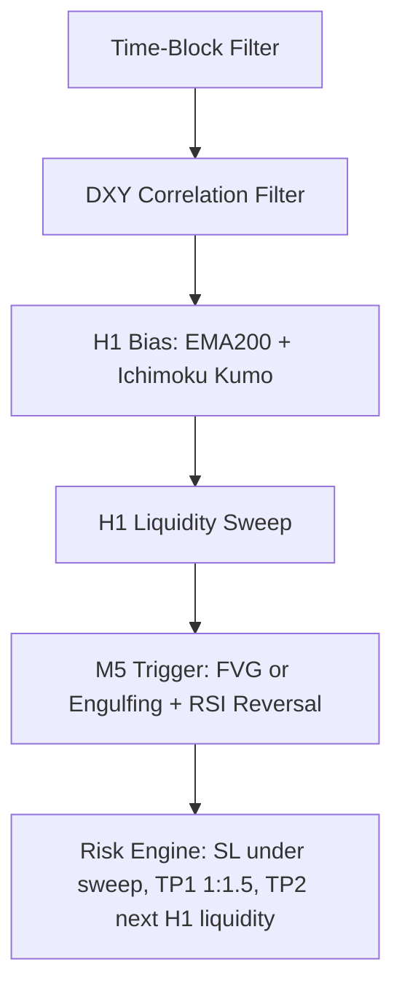

# SignalBot Monorepo

Professional XAU/USD signal platform built as a monorepo:

- `backend/` - Python + MetaTrader5 + `supabase-py`
- `frontend/` - Next.js App Router + Tailwind CSS + Framer Motion
- `supabase/` - shared database schema and realtime contract

## Structure

```text
SignalBot/
  backend/
    .env.example
    requirements.txt
    src/
      clients/
      config/
      data/
      models/
      services/
      strategy/
      utils/
      main.py
  frontend/
    .env.example
    app/
    components/
    lib/
    types/
    package.json
  supabase/
    schema.sql
  README.md
```

## Runtime Flow

1. MT5 streams XAU/USD and DXY prices into the Python process.
2. Backend keeps rolling market windows in RAM and evaluates AlphaNode V2.
3. Backend writes market snapshots and signal state to Supabase.
4. Frontend listens with Supabase Realtime and updates the dashboard instantly.

## Backend Quick Start

1. Copy `backend/.env.example` to `backend/.env`
2. Fill:
   - `SUPABASE_URL`
   - `SUPABASE_SERVICE_ROLE_KEY`
   - `MT5_SYMBOL`
   - `DXY_SYMBOL`
   - optional MT5 login fields
3. Run:

```bash
cd backend
python -m venv .venv
.venv\Scripts\activate
pip install -r requirements.txt
python -m src.main
```

### Important backend variables

- `SEED_CANDLE_COUNT` - M1 history used to derive M5 execution windows
- `H1_SEED_CANDLE_COUNT` - XAU H1 bias history
- `DXY_SEED_H1_COUNT` - DXY H1 bias history
- `SIGNAL_EXPIRY_MINUTES` - hard timeout for stale trades
- `TRADING_TIMEZONE` - local session clock, default `Europe/Warsaw`

## Tryb Backtest

Tryb `BACKTEST` pozwala uruchomić silnik AlphaNode V2 na historycznych świecach pobranych z MetaTrader 5. Jest to narzędzie diagnostyczne do sprawdzania, czy strategia generuje sygnały w oczekiwanych miejscach rynku, bez publikowania ich do Supabase i bez uruchamiania frontendu.

### Jak uruchomić

W pliku `backend/.env` ustaw:

```env
APP_MODE=BACKTEST
SUPABASE_URL=https://your-project.supabase.co
MT5_SYMBOL=XAUUSD
DXY_SYMBOL=DXY
BACKTEST_CSV_PATH=backtest_results.csv
SEED_CANDLE_COUNT=400
H1_SEED_CANDLE_COUNT=260
DXY_SEED_H1_COUNT=260
```

Następnie uruchom backend tak samo jak w trybie produkcyjnym:

```bash
cd backend
python -m src.main
```

Uwaga: nawet w trybie `BACKTEST` aplikacja nadal inicjalizuje MetaTrader 5, ponieważ dane historyczne są pobierane z terminala MT5. Terminal musi być uruchomiony, zalogowany i musi mieć dostęp do symboli ustawionych w `MT5_SYMBOL` oraz `DXY_SYMBOL`.

`SUPABASE_SERVICE_ROLE_KEY` nie jest wymagany do zapisu w trybie `BACKTEST`, ale obecny loader konfiguracji nadal wymaga `SUPABASE_URL`, więc zostaw w `.env` poprawny adres projektu Supabase albo dowolną wartość testową zgodną z formatem URL.

### Co dokładnie robi backtest

1. Backend startuje w trybie `BACKTEST`, gdy `APP_MODE=BACKTEST`.
2. `MT5Client` pobiera historyczne świece:
   - M1 dla XAU/USD z `SEED_CANDLE_COUNT`
   - H1 dla XAU/USD z `H1_SEED_CANDLE_COUNT`
   - H1 dla DXY z `DXY_SEED_H1_COUNT`
3. Silnik `RollingSignalEngineMTF` jest zasiewany początkowym fragmentem danych historycznych.
4. Backtest przechodzi świeca po świecy po historii M1.
5. Przy każdej świecy M1 silnik aktualizuje kontekst H1 oraz DXY H1 tylko tymi świecami, które faktycznie byłyby już znane w danym momencie testu.
6. Silnik wywołuje `evaluate_signal(...)` dokładnie tak jak w trybie live.
7. Jeśli pojawi się sygnał, backend buduje obiekt sygnału i symuluje wynik na podstawie zamknięcia następnej świecy M1.
8. Wyniki są zapisywane do pliku CSV, domyślnie `backend/backtest_results.csv`.
9. Na końcu backend wypisuje w logach raport: liczba sygnałów, winrate, suma pipsów, liczba wygranych i przegranych.

### Plik wynikowy CSV

CSV zawiera następujące kolumny:

- `candle_time` - czas świecy, na której pojawił się sygnał
- `symbol` - testowany symbol, np. XAU/USD u danego brokera
- `type` - kierunek sygnału, `Buy` albo `Sell`
- `status` - w backteście wpisy są zapisywane jako `CLOSED`
- `reason` - powód wygenerowania sygnału zwrócony przez strategię
- `confidence` - ocena pewności setupu
- `entry_price` - cena wejścia wyliczona przez silnik
- `exit_price` - cena wyjścia użyta w symulacji
- `dxy_bias` - kontekst DXY
- `session_name` - sesja rynkowa, np. London / NY / Monitoring
- `liquidity_cleared` - czy warunek sweepu płynności został spełniony
- `result_pips` - wynik w pipsach

### Jak interpretować wynik

Backtest w obecnej wersji jest szybkim testem logiki sygnałów, a nie pełnym symulatorem egzekucji brokerskiej. Wynik `result_pips` jest liczony względem następnego zamknięcia M1, więc służy głównie do oceny, czy sygnał pojawia się w sensownym kierunku i kontekście.

To oznacza, że backtest:

- pomaga sprawdzić, czy filtry H1, DXY, sesji i sweepu działają razem
- pozwala szybko zobaczyć liczbę sygnałów oraz ich rozkład
- tworzy CSV do ręcznej analizy w Excelu, Google Sheets lub Pythonie
- nie uwzględnia spreadu, prowizji, poślizgu ani realnego wykonania zleceń
- nie sprawdza intrabar, czy TP/SL zostały trafione wewnątrz kolejnej świecy
- nie zapisuje sygnałów do Supabase i nie aktualizuje dashboardu

### Najczęstsze problemy

- `Not enough M1 candles for backtest` oznacza, że MT5 zwrócił mniej niż 120 świec M1. Zwiększ zakres historii w terminalu MT5 lub sprawdź nazwę symbolu.
- Brak sygnałów nie musi oznaczać błędu. AlphaNode V2 ma restrykcyjne filtry: H1 Bias, DXY, Time-Block, Liquidity Sweep i M5 Trigger.
- Jeśli broker używa niestandardowych nazw instrumentów, ustaw dokładne wartości `MT5_SYMBOL` i `DXY_SYMBOL` zgodnie z Market Watch w MT5.
- `BACKTEST_CSV_PATH` może być ścieżką względną lub absolutną. Ścieżka względna jest liczona od katalogu `backend/`.

## Frontend Quick Start

1. Copy `frontend/.env.example` to `frontend/.env.local`
2. Fill:
   - `NEXT_PUBLIC_SUPABASE_URL`
   - `NEXT_PUBLIC_SUPABASE_ANON_KEY`
3. Run:

```bash
cd frontend
npm install
npm run dev
```

Dashboard:

- `http://localhost:3000/dashboard`

## Supabase Setup

Apply [supabase/schema.sql](C:\Users\gmdam\Documents\GitHub\SignalBot\supabase\schema.sql) in Supabase SQL Editor.

The schema provides:

- `market_data` with one live row per symbol
- `signals` with lifecycle states and AlphaNode V2 context fields
- public read policies for frontend consumption
- realtime publication for both tables

## AlphaNode V2 Strategy Handbook

AlphaNode V2 replaces the older indicator-score approach with a hierarchy based on market structure, environment filters and liquidity behavior.

### Decision Hierarchy



Why this order matters:

- If session liquidity is poor, execution is disabled before technical signals are considered.
- If DXY is hostile for gold longs, the engine blocks long setups even when XAU looks attractive on local indicators.
- Only after environment conditions are valid does the engine look for liquidity events and M5 triggers.

### H1 Bias / M5 Execution Architecture

Layer 1: H1 Directional Bias

- XAU H1 price is evaluated against EMA 200.
- XAU H1 price must also be positioned above or below the Ichimoku cloud.
- DXY H1 is evaluated independently and can block long gold setups.
- Session windows:
  - `LONDON_OPEN`: 09:00 - 12:00 local trading time
  - `NY_OPEN_OVERLAP`: 14:30 - 18:30 local trading time
  - Outside these windows the engine stays in `MONITORING`

Layer 2: Liquidity Sweep

- The engine scans the last 24 H1 candles for swing highs and swing lows.
- A long setup requires a sweep below the tracked H1 swing low and a reclaim above that level within 3 M5 candles.
- A short setup mirrors the same logic above H1 swing highs.

Layer 3: M5 Execution Trigger

- After liquidity is cleared, the engine waits for:
  - bullish or bearish Fair Value Gap
  - or bullish / bearish engulfing
  - plus RSI reversal from exhaustion
- Stop loss is anchored beyond the candle that performed the sweep.
- TP1 is fixed at 1:1.5 RR.
- TP2 is the next H1 liquidity pool and is stored in metadata.

### Psychology of the System

AlphaNode V2 follows the Smart Money Concepts idea that the cleanest move often comes after the market first runs liquidity.

Why the system waits for the sweep:

- Retail traders often place stops around obvious highs and lows.
- Stronger players can push price through those levels to collect liquidity.
- Entering before that event often means buying directly into the trap.
- By waiting for the sweep and then a reclaim, the system looks for confirmation that the manipulation has already happened.

In practice this means AlphaNode V2 prefers:

- patience over frequency
- execution after displacement, not before
- structural confirmation over raw indicator crossover events

### Technical Stack

- Python process:
  - receives live MT5 ticks
  - maintains M1, M5, H1 and DXY H1 rolling windows in RAM
  - computes bias, sweep state, trigger and risk parameters
- MT5:
  - provides XAU/USD and DXY market data
  - remains the low-latency source of truth for live prices
- Supabase:
  - stores `market_data` snapshots and `signals`
  - distributes updates to the frontend through Realtime

## Data Contract

### `signals`

Core columns:

- `id`
- `symbol`
- `type`
- `entry_price`
- `tp`
- `sl`
- `status`
- `timestamp`
- `expires_at`

AlphaNode V2 fields:

- `dxy_bias`
- `session_name`
- `liquidity_cleared`
- `indicator_snapshot`
- `metadata`

### `market_data`

Each row contains a single live snapshot per symbol.

For XAU the `extra` field now carries:

- `market_health_score`
- `market_health_components`
- `bias_side`
- `trend_state`
- `session_name`
- `execution_mode`
- `dxy_bias`
- `liquidity_cleared`
- `reference_liquidity`

For DXY the `extra` field carries:

- `dxy_bias`
- `ema200`
- `ema_slope`
- `market_health_score`

This allows the frontend to build a Market Health Score panel without recomputing backend logic in the browser.

## Notes

- Frontend reads data with the public anon key only.
- Backend writes with the Supabase service role key.
- If your broker uses a different DXY symbol name, override `DXY_SYMBOL` in `backend/.env`.
- TradingView widget is client-side and loads an external script in the frontend.
